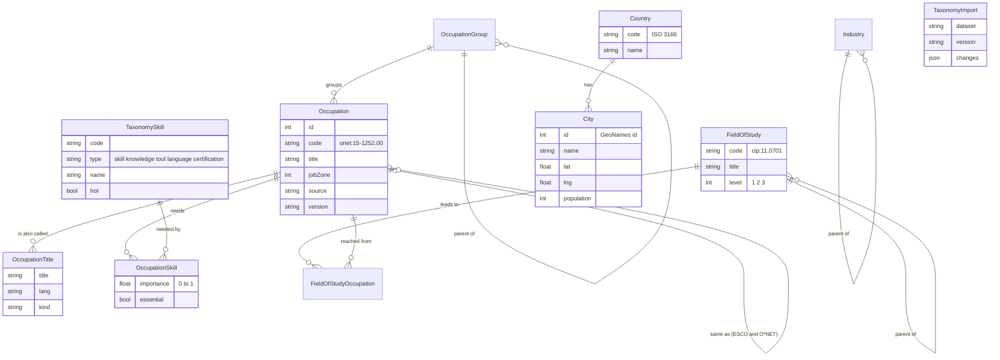

# The taxonomy: every job, title, skill and major (P6-03 onward)

Job Radar needs to know that "Frontend Engineer" is a kind of software developer, that it needs JavaScript, and that
people who study Computer Science often go there. That knowledge comes from open standards, imported into these tables
(the same for everyone) by `pnpm taxonomy:import` (P6-04).

## Where it comes from

| Dataset | What we take | Licence | How to get it |
|---|---|---|---|
| **O\*NET 30.1** (US Dept. of Labor) | ~1,000 occupations, their job zone, ~57,000 alternate titles, skills and knowledge with importance, ~8,000 technologies ("hot" ones marked) | CC BY 4.0: credit "O\*NET 30.1 Database, U.S. Department of Labor, Employment and Training Administration" | Downloaded automatically |
| **ESCO** (European Commission) | ~3,000 occupations, ~14,000 skills, essential/optional links, labels in 25+ languages | Free with attribution ("ESCO, European Commission") | Download the CSV files yourself at esco.ec.europa.eu → Download (a form), put them in `data/taxonomy/esco/` |
| **CIP 2020 + CIP–SOC 2018 crosswalk** (NCES/BLS) | Fields of study in a tree, and which occupations each one leads to | Public domain | Downloaded automatically |
| **GeoNames** | Countries, and cities with 15,000+ people | CC BY 4.0: credit "GeoNames" | Downloaded automatically |
| **SOC 2018 major groups / NAICS sectors** | The occupation browse tree and the industry list | Public domain | Built in |

The credits are shown on the Radar's About page.

## Tables

The job enums used by postings and filters: `EmploymentType` (full_time, part_time, internship, apprenticeship,
contract, freelance, volunteer, student_job), `Seniority` (student, intern, entry, junior, mid, senior, lead),
`WorkMode` (onsite, hybrid, remote), `EducationLevel` (none … doctorate), `SkillType`.

Every row keeps `source` and `version`, and `TaxonomyImport` records each run. Importing a newer release goes over the
old one; importing the same one again changes nothing.
